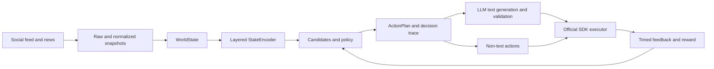

# CTN Agent

**A state based social agent for the fictional Capture the Narrative competition.**

The [full technical report](docs/CTN_Agent_Technical_Report.md) explains the design, formulas, implementation, experiments, and limitations. It is written in Chinese. This README is a short entry point for readers and interviewers.

## What it does

CTN Agent observes a simulated social feed and news sites, rebuilds a structured world state from saved snapshots, evaluates possible actions, generates source grounded text when needed, executes actions through the official SDK, and records delayed feedback. The code separates environmental facts, agent history, decision scores, generated text, execution outcomes, and observed rewards.



The policy can use an interpretable heuristic or a contextual LinUCB model with Softmax sampling. It considers CREATE_POST, REPLY, LIKE, REPOST, FOLLOW, MENTION, and WAIT. The learning path is enabled separately with `CTN_ENABLE_LEARNING=true` and `--policy bandit`; selecting `--policy heuristic` does not train LinUCB.

## Implementation highlights

- **Rebuildable state:** raw observations, normalized posts/articles/events, and historical snapshots are stored separately. Missing history and incomplete topic classification have explicit indicators.
- **Layered encoding:** 12 global features; 8 per post; 1 per event; 2 per topic. Object IDs stay associated with their vectors.
- **Traceable decisions:** candidate features, scores, exploration terms, selection probabilities, writing profiles, and final plans can be inspected after each round.
- **Distinct writing tasks:** posts and replies have separate prompts. Generated content is checked for format, topical relevance, and supported claims before publication. News posts can attach the original article URL.
- **Delayed feedback:** scheduled windows track each published post or reply by action ID and remote ID. Reply feedback is kept separate from changes on its parent post.
- **Bounded learning:** final action rewards can update the contextual model. Decision priority, observed reward, and exploration are recorded separately; a post's popularity is not treated as proof that the action caused it.

## Observed outcome

The [sanitized final scoring export](docs/data/final_scoring_events.csv) contains 16 scoring batches totaling **1,311 points**. Those batches report 123 scored views, 14 likes, 7 replies, 1 follow, and two contributions toward the assigned side. These are platform aggregates, not a controlled comparison or evidence that any single prompt or policy change caused the result. The [technical report](docs/CTN_Agent_Technical_Report.md) gives the measurement window, database counts, and known consistency limits.

## Run locally

The project was developed with Python 3.10 and the dependencies in `requirements.txt`.

```powershell
python -m venv .venv
.\.venv\Scripts\python.exe -m pip install -r requirements.txt
Copy-Item .env.example .env
```

Fill in `.env` only if you have your own platform credentials. The repository does not contain credentials, raw observations, SQLite databases, or runtime logs. The default CLI mode is `dry-run`; platform writes require an explicit `--mode live`.

For an offline replay, provide a `RawSnapshot` JSON fixture of your own:

```powershell
.\.venv\Scripts\python.exe -B main.py --mode dry-run --fixture path\to\snapshot.json --offline-llm --once
```

Run the offline regression tests:

```powershell
.\.venv\Scripts\python.exe -B -m unittest test_policy test_content_regression test_v02 test_learning_policy test_v03 test_action_policy test_llm_client
```

The original competition environment may no longer accept live actions; the offline tests and technical report are the reproducible part of this repository.

## Repository map

| Path | Purpose |
|---|---|
| [`state/`](state/) | Observation, normalization, persistence, topic classification, WorldState, encoding |
| [`policy/`](policy/) | Candidates, scoring, Softmax/LinUCB selection, reward evaluation |
| [`agent/`](agent/) | Runtime, content generation, execution, history, feedback collection |
| [`analytics/`](analytics/) | Offline policy and feedback analysis |
| [`docs/CTN_Agent_Technical_Report.md`](docs/CTN_Agent_Technical_Report.md) | Complete technical report with diagrams, formulas, evaluation, and limitations |
| [`docs/ADR.md`](docs/ADR.md) | Architecture decisions |

This project concerns a fictional, controlled competition environment. The included measurements are observational and should not be interpreted as causal effects.
